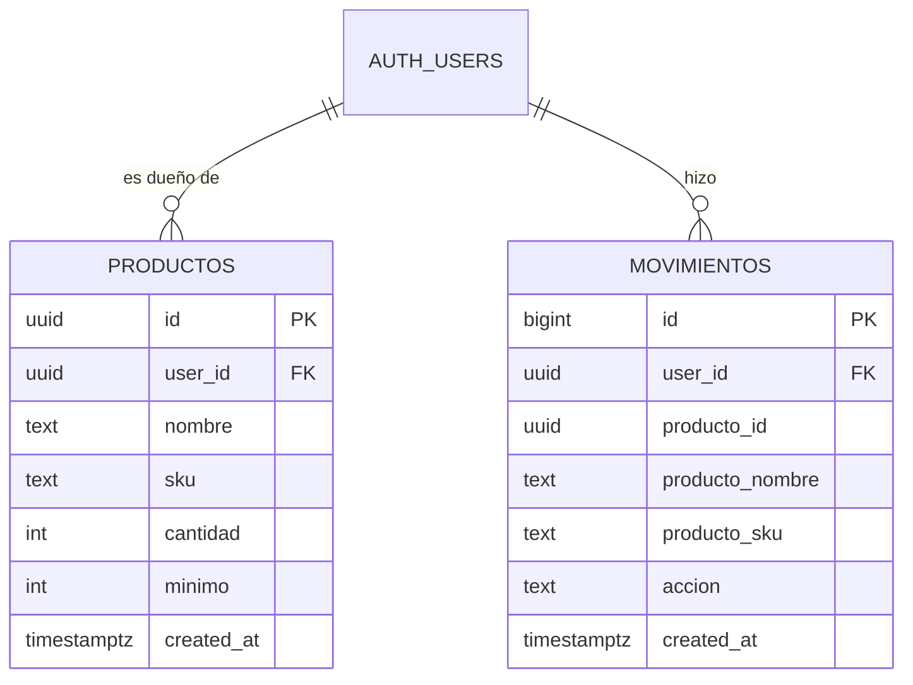
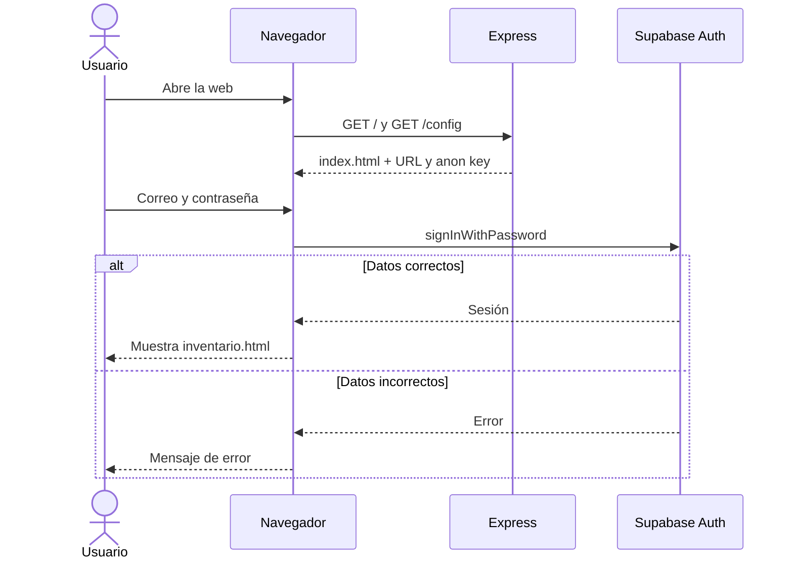

# Diseño técnico — Mini Inventario

## Tecnología

| Pieza | Uso |
|---|---|
| Node.js 22 + Express | Sirve los archivos de la página (`public/`). No tiene API propia. |
| HTML + JavaScript sin framework | Formularios, lista, historial. Habla con Supabase usando `@supabase/supabase-js`. |
| Supabase Auth | Registro e inicio de sesión con correo y contraseña. |
| Supabase (Postgres) | Tablas `productos` y `movimientos`, con Row Level Security (RLS). |

Las llaves de Supabase van en `.env` (nunca se suben). Express solo entrega al navegador la URL y la llave pública `anon`; la llave `service_role` no se usa en este proyecto.

## Estructura de archivos

```
server.js          Express: sirve public/ y /config (URL + anon key)
public/
  index.html       Inicio de sesión y registro
  inventario.html  Lista, formulario e historial
  app.js           Lógica del navegador
  styles.css
supabase/
  schema.sql       Tablas, restricciones, RLS y trigger
```

## Base de datos

### Tabla `productos`

| Columna | Tipo | Regla |
|---|---|---|
| id | uuid | Llave primaria, `default gen_random_uuid()` |
| user_id | uuid | Obligatorio, referencia a `auth.users(id)`, `default auth.uid()` |
| nombre | text | Obligatorio, no vacío |
| sku | text | Obligatorio, `^[A-Za-z0-9-]+$`, único junto con `user_id` |
| cantidad | integer | Obligatorio, `>= 0` |
| minimo | integer | Obligatorio, `>= 5` |
| created_at | timestamptz | `default now()` |

### Tabla `movimientos` (historial, H5)

| Columna | Tipo | Regla |
|---|---|---|
| id | bigint | Llave primaria, identidad |
| user_id | uuid | Quién hizo el cambio |
| producto_id | uuid | Producto afectado (sin llave foránea, para que el registro sobreviva al borrado) |
| producto_nombre | text | Copia del nombre al momento del cambio |
| producto_sku | text | Copia del SKU al momento del cambio |
| accion | text | `alta`, `edicion` o `borrado` |
| created_at | timestamptz | `default now()` |

Los registros los crea un **trigger** de Postgres en `productos` (después de insert, update y delete). Así el historial no depende de que el navegador se acuerde de guardarlo, y el usuario no puede escribir en `movimientos` directamente.

```sql
create table productos (
  id uuid primary key default gen_random_uuid(),
  user_id uuid not null default auth.uid() references auth.users(id),
  nombre text not null check (length(trim(nombre)) > 0),
  sku text not null check (sku ~ '^[A-Za-z0-9-]+$'),
  cantidad integer not null check (cantidad >= 0),
  minimo integer not null check (minimo >= 5),
  created_at timestamptz not null default now(),
  unique (user_id, sku)
);
```

## Qué valida cada capa

| Capa | Qué valida | Por qué |
|---|---|---|
| Navegador (HTML + JS) | Campos obligatorios, formato del SKU, enteros, `cantidad >= 0`, `minimo >= 5`, confirmación antes de borrar. | Dar mensajes claros al instante. **No es seguridad**: se puede saltar. |
| Express | Nada de datos del inventario; solo sirve archivos y la configuración pública. | No tiene API, así que no hay nada que validar ahí. Evita piezas innecesarias. |
| Supabase Auth | Correo y contraseña válidos; emite la sesión del usuario. | Identidad. |
| Postgres (restricciones) | `not null`, `check` de SKU/cantidad/mínimo, `unique (user_id, sku)`. | Última línea de defensa: datos inválidos no entran aunque alguien salte el navegador. |
| Postgres (RLS) | `productos`: select/insert/update/delete solo si `user_id = auth.uid()`. `movimientos`: solo select de los propios; sin insert/update/delete para usuarios. | Cada quien ve y modifica solo lo suyo (H1, H3, H4, H5). |

## Diagramas

### Tablas



### Flujo de inicio de sesión


